# Dependency Graph

**Last updated:** 0000036-pipeline-friction-and-gate-fixes (23 Oct 2026). `planifest-framework` is at 0.34.0. `skill-drift-check.mjs` and `em-dash-guard.mjs` now import `path-rules.mjs`. No component dependency changed.
**Maintained by:** planifest-docs-agent

---

## Component Dependency Diagram

```mermaid
graph TD
    subgraph "planifest-framework (component-pack, 0.34.0)"
        SKILLS["skills/ (orchestrator + phase agents)"]
        STANDARDS["standards/, templates/"]
        ENFORCE["hooks/enforcement/\n(gate-write, check-design,\nem-dash-guard)"]
        SWG["hooks/enforcement/shell-write-guard.mjs\n(Bash PreToolUse, Claude Code only, 0000032)"]
        ENFSHARED["hooks/enforcement/ shared modules\n(read-stdin.mjs)\nalways installed"]
        SCRIPTS["scripts/\n(archive-current, stream-reconcile,\nrun-mode, 0000033)"]
        SPR["scripts/set-product-release.mjs\n(P7 product.yml update, 0000035)"]
        SDC["scripts/skill-drift-check.mjs\n(warn-only drift check, 0000036)"]
        EDG["hooks/enforcement/em-dash-guard.mjs\n(Write/Edit)"]
        RATCHET["hooks/enforcement/ratchet-check.mjs\n(Write/Edit, armed while a loop is active)"]
        PATHRULES["hooks/enforcement/path-rules.mjs\n(gated-path rules, repository root,\nlink resolution, scope record,\nshared module, always installed, 0000032/0000035)"]
    end

    subgraph "Claude Code Runtime"
        CC[Claude Code Agent]
        HookRunner["PreToolUse Hook Runner\n(Claude Code internal)"]
    end

    subgraph "setup-hook-integration (component-pack)"
        SH["setup.sh / setup.ps1"]
        SKS["skill-sync.sh"]
        MARKER[".planifest-setup-flags\n(per tool dir)"]
    end

    subgraph "planifest-refresh-setup (skill, 0000020)"
        RS["planifest-refresh-setup/SKILL.md"]
        DEL["refresh-delete-boot-files.sh/.ps1"]
    end

    subgraph "System Tools (runtime deps)"
        NODE["node (required, sole runtime)"]
    end

    CC -->|"plans Write/Edit call"| HookRunner
    SH -->|"reads hooks/skills/templates from"| ENFORCE
    SH -->|"copies skills into IDE-discovered dir"| SKILLS
    SKS -->|"syncs external skills for"| SKILLS
    ENFORCE -->|"wired via"| HookRunner
    HookRunner -->|"PreToolUse Write/Edit"| ENFORCE
    ENFORCE -->|"reads Component Paths from"| STANDARDS

    ENFORCE --- NODE
    ENFORCE -.->|"imports"| ENFSHARED
    ENFORCE -.->|"gate-write imports"| PATHRULES
    SWG -.->|"imports"| PATHRULES
    SWG -.->|"imports"| ENFSHARED
    HookRunner -->|"PreToolUse Bash"| SWG
    SWG --- NODE
    SH -->|"registers on Bash matcher, idempotent"| SWG
    SH -->|"copies *.mjs unconditionally"| ENFSHARED

    SKILLS -->|"ship agent and orchestrator call"| SCRIPTS
    SCRIPTS --- NODE
    SKILLS -->|"ship agent calls at P7"| SPR
    SPR -.->|"imports resolveRoot"| PATHRULES
    SPR --- NODE
    SKILLS -->|"orchestrator runs in Resume Detection"| SDC
    SDC -.->|"imports shown"| PATHRULES
    SDC --- NODE
    HookRunner -->|"PreToolUse Write/Edit"| EDG
    EDG -.->|"imports shown"| PATHRULES
    EDG -.->|"imports"| ENFSHARED
    EDG --- NODE
    HookRunner -->|"PreToolUse Write/Edit"| RATCHET
    RATCHET -.->|"imports resolveRoot, resolveTargetBoth, shown"| PATHRULES
    RATCHET -.->|"imports"| ENFSHARED

    SH -->|"writes on successful install"| MARKER
    RS -->|"reads (reconstruction) and writes (pre-deletion cache)"| MARKER
    RS -->|"invokes"| DEL
    RS -->|"re-invokes with confirmed flags"| SH
```

---

## Dependency Direction Notes

- `setup-hook-integration` → `planifest-framework`: `setup.sh`/`setup.ps1` are the sole distribution mechanism: they copy `skills/`, `hooks/enforcement/`, `templates/`, and `standards/` into whichever directory the target agentic tool auto-discovers. One-way; `planifest-framework` has no dependency back on `setup-hook-integration`.
- `planifest-framework`'s `hooks/enforcement/` → Claude Code's PreToolUse hook runner: `gate-write.mjs` and `ratchet-check.mjs` are invoked on every Write/Edit; `ratchet-check.mjs` additionally reads `plan/current/loop-state-*.md` (not shown, not a component, a runtime artifact) to decide whether it is armed.
- `gate-write.mjs` and `shell-write-guard.mjs` → `path-rules.mjs` (0000032-ADR-004): both import the same module and keep no copy of the rules. `path-rules.mjs` imports Node built-ins only. It reads `plan/.orchestrator-active` and `plan/current/design.md` from the repository root it resolves. A broken import fails both hooks at module load, before their own `try`, so both stop enforcing at once (0000028-ADR-004).
- `ratchet-check.mjs` → `path-rules.mjs` (0000035-ADR-007): it imports `resolveRoot`, `resolveTargetBoth`, and `shown`. It also imports `hookCwd`, `norm`, and `MAX_PATH_CHARS`. It keeps no root or path logic of its own. Its `git status` backstop still spawns `git` (backlog 0000128).
- `set-product-release.mjs` → `path-rules.mjs` (0000035-ADR-010): the script imports `resolveRoot` across folders, from `scripts/` into `hooks/enforcement/`. Both folders sit inside `planifest-framework`, so no component dependency changed. The script clears `CLAUDE_PROJECT_DIR` for the call, so the root comes from the working folder only.
- `skill-drift-check.mjs` → `path-rules.mjs` (0000036-ADR-004, ADR-005): the script imports `shown` across folders, from `scripts/` into `hooks/enforcement/`. `planifest-orchestrator` runs the script in Resume Detection. It warns and never blocks. Both folders sit inside `planifest-framework`, so no component dependency changed.
- `em-dash-guard.mjs` → `path-rules.mjs` (0000036-ADR-004): it imports `shown` so a control character in a target path can't forge a line of hook output. It also imports `readStdin` from `read-stdin.mjs`. A broken import fails the hook at module load.
- `path-rules.mjs` still imports Node built-ins only and no `node:child_process` (0000035-ADR-001). It now also reads `plan/.fast-path-scope` and git state from `.git` files.
- `planifest-framework`'s `hooks/enforcement/shell-write-guard.mjs` → Claude Code's Bash PreToolUse hook runner (0000032-ADR-006): `setup.sh` and `setup.ps1` register it for Claude Code only. Other tools don't run it.
- `planifest-ship-agent` and `planifest-orchestrator` → three scripts in `planifest-framework/scripts/` (0000033). The ship agent calls `archive-current.mjs` at P7 and `run-mode.mjs` for the effective run mode. The orchestrator calls `stream-reconcile.mjs` after each join and `run-mode.mjs` after P0. The scripts use Node built-ins and `git`. All of this stays inside `planifest-framework`, so no component dependency changed.
- `planifest-refresh-setup` (0000020) -> `setup-hook-integration`: two-way relationship via the `.planifest-setup-flags` marker file. `setup.sh`/`setup.ps1` write it on every successful install (producer); the refresh skill reads it for reconstruction and writes to it again before deletion (consumer and secondary writer of the same file, ADR-002). The refresh skill also re-invokes `setup.sh`/`setup.ps1` directly once flags are confirmed, and calls `refresh-delete-boot-files.sh`/`.ps1` (its own hardcoded deletion script, not a dependency on `setup-hook-integration`).

---

## Planned Components (future pipelines)

| Planned Component | Depends On | Provides |
|-------------------|-----------|---------|
| `mcp-workspace-server` | N/A | Workspace tools for multi-repo operations |
