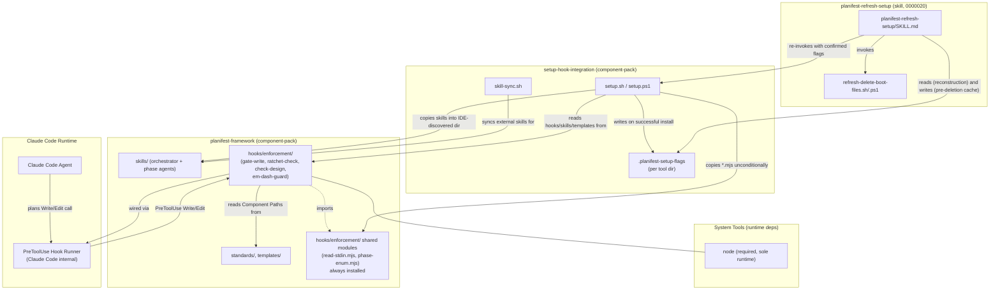

# Dependency Graph

**Last updated:** 0000030-context-mode-and-telemetry-mcp-removal (14 Oct 2026). The two retired hook integrations and their external services are removed from the graph.
**Maintained by:** planifest-docs-agent

---

## Component Dependency Diagram

---

## Dependency Direction Notes

- `setup-hook-integration` → `planifest-framework`: `setup.sh`/`setup.ps1` are the sole distribution mechanism: they copy `skills/`, `hooks/enforcement/`, `templates/`, and `standards/` into whichever directory the target agentic tool auto-discovers. One-way; `planifest-framework` has no dependency back on `setup-hook-integration`.
- `planifest-framework`'s `hooks/enforcement/` → Claude Code's PreToolUse hook runner: `gate-write.mjs` and `ratchet-check.mjs` are invoked on every Write/Edit; `ratchet-check.mjs` additionally reads `plan/current/loop-state-*.md` (not shown, not a component, a runtime artifact) to decide whether it is armed.
- `planifest-refresh-setup` (0000020) -> `setup-hook-integration`: two-way relationship via the `.planifest-setup-flags` marker file. `setup.sh`/`setup.ps1` write it on every successful install (producer); the refresh skill reads it for reconstruction and writes to it again before deletion (consumer and secondary writer of the same file, ADR-002). The refresh skill also re-invokes `setup.sh`/`setup.ps1` directly once flags are confirmed, and calls `refresh-delete-boot-files.sh`/`.ps1` (its own hardcoded deletion script, not a dependency on `setup-hook-integration`).

---

## Planned Components (future pipelines)

| Planned Component | Depends On | Provides |
|-------------------|-----------|---------|
| `mcp-workspace-server` | N/A | Workspace tools for multi-repo operations |
