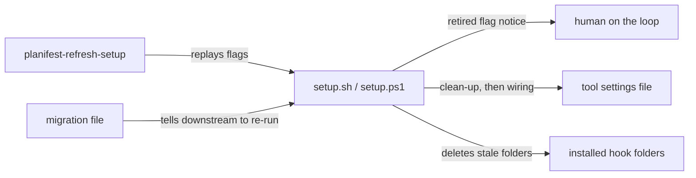

# Execution Plan - Context Mode and Telemetry MCP removal

> Every requirement must be traceable to a user story or acceptance criterion.

**Skill:** [spec-agent](../../planifest-framework/skills/planifest-spec-agent/SKILL.md)
**Feature:** 0000030-context-mode-and-telemetry-mcp-removal
**Wave:** 1 (single wave)
**Version:** 0.29.0
**Status:** active

## Active Skills

| Skill | Scope | Purpose |
|-------|-------|---------|
| None | n/a | No capability skills apply to a Bash, PowerShell, and Node hook stack |

## Functional Requirements Directory

Functional requirements are split into individual files, one user story per file, at `plan/current/requirements/`.

| File | Requirement |
|------|------------|
| [req-001-context-mode-removal.md](requirements/req-001-context-mode-removal.md) | Delete every Context Mode hook, install path, component, doc, and test (US-001) |
| [req-002-telemetry-hook-and-setup-removal.md](requirements/req-002-telemetry-hook-and-setup-removal.md) | Delete the telemetry hooks, backstops, helpers, install paths, and CI job (US-002, code) |
| [req-003-telemetry-pipeline-text-removal.md](requirements/req-003-telemetry-pipeline-text-removal.md) | Remove telemetry from skills, templates, standards, guides, and living docs (US-002, text) |
| [req-004-install-clean-up-and-retired-flags.md](requirements/req-004-install-clean-up-and-retired-flags.md) | Accept the three retired flags, and clean stale state on every setup run (US-003) |
| [req-005-refresh-setup-migration-and-self-hosting.md](requirements/req-005-refresh-setup-migration-and-self-hosting.md) | Update refresh-setup, remove this repo's own wiring last, and ship the migration (US-003) |

US-002 implies more than three acceptance criteria, so it is split across REQ-002 (code) and REQ-003 (text). US-003 is split the same way across REQ-004 (setup behaviour) and REQ-005 (refresh, migration, and self-hosting).

### Build order

1. REQ-004 first. Setup must accept the retired flags before any install path is removed.
2. REQ-001 and REQ-002 next. They touch different hook folders, but both edit the setup scripts, so they run one after the other.
3. REQ-003 in parallel with REQ-001 and REQ-002. It touches only prose files, apart from tests that grep skill text.
4. REQ-005 last. Its migration file is the final P3 commit.

## Non-Functional Requirements

| ID | Category | Requirement | Target | Measurement |
|----|----------|------------|--------|-------------|
| NFR-001 | Maintainability | No residual references | 0 case-insensitive matches for `context-mode`, `context_mode`, `context mode`, `structured-telemetry`, `telemetry`, `emit_event`, and `backend-url` outside the allowlist below | `git grep -il` at P4, checked against the allowlist |
| NFR-002 | Reliability | Setup is idempotent | A second run of `setup.sh claude-code` changes 0 files | Fixture project, `git status --porcelain` after the second run |
| NFR-003 | Reliability | Clean-up is exact | 0 stale entries, folders, or files after one re-run, and 100% of non-matching entries kept | Fixture with both integrations plus one hand-added hook |
| NFR-004 | Reliability | Setup fails open | Exit code 0 for each retired flag, a malformed settings file, and a missing Node | Fixture runs, one per case |
| NFR-005 | Quality | Test suite passes | `planifest-framework/tests/run-tests.sh` exits 0, and CI passes | Local run at P4, and CI on the PR |

### NFR-001 allowlist

- `plan/_archive/`, `plan/changelog/`, `plan/current/`, and `plan/backlog/`
- `planifest-framework/external-skills/`: third-party skills that use "telemetry" in its general sense
- `planifest-framework/standards/reference/backend-stack-evaluation.md`: names OpenTelemetry and the Elixir `:telemetry` library, which are general observability tools
- Feature IDs that contain these words, such as `0000029-context-mode-removal-...` and `0000030-context-mode-and-telemetry-mcp-removal`
- The retired-flag and clean-up blocks in `setup.sh`, `setup.ps1`, and `setup/*.sh` / `setup/*.ps1`, each fenced by a marker comment so the check can find the block
- The tests for REQ-003, REQ-004, and REQ-005, plus comments and absence assertions in older tests (for example `test-0000029-...` asserting `standard-boot.md` has no `context-mode` text)
- `planifest-framework/migrations/migrate-remove-context-mode-and-telemetry.md`
- The retired-flag note in `planifest-refresh-setup/SKILL.md`
- The superseded entries and this feature's entry in `docs/decisions-index.md`, and this feature's iteration log

## API Summary

Not applicable. This feature builds or changes no API.

## Data Model Summary

No schema exists. The files below hold state that this feature changes.

| Entity | Owner Component | Key Fields | Relationships |
|--------|----------------|------------|--------------|
| Tool settings file (for example `.claude/settings.json`) | `setup-hook-integration` | `hooks.{event}[].matcher`, `hooks.{event}[].hooks[].command` | Commands point at installed hook files |
| Install marker (`planifest-overrides/setup-config/{tool}.md`) | `setup-hook-integration` | `flags` | Read by `planifest-refresh-setup` |
| `product.yml` | `planifest-framework` | `id`, `version`, `components[]` | Read by `scripts/product-version.mjs` |
| `build-log.md` template | `planifest-framework` | Per-phase block fields | Read by the P8 build assessment |

## Component Interactions

## Assumptions

Each is a risk item with likelihood: medium. The risk register holds them as A-001 to A-003.

| ID | Assumption | Impact if Wrong |
|----|-----------|----------------|
| A-001 | No downstream project depends on telemetry events beyond what the framework consumed | That project loses data, and the migration file is its only notice |
| A-002 | CI can exercise `setup.ps1`, because `pwsh` isn't installed locally | A PowerShell-only defect ships. P4 confirms what CI runs |
| A-003 | The 27 open backlog entries need no change beyond passing mentions | An entry describes deleted code, and the next backlog pickup catches it |

## Open Questions

None. Every question raised at P0 has a recorded answer in `build-log.md`.
