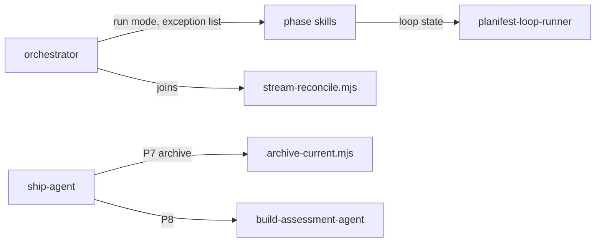

# Execution Plan - human-on-the-loop run mode

> Every requirement must be traceable to a user story or acceptance criterion.

**Skill:** [spec-agent](../../planifest-framework/skills/planifest-spec-agent/SKILL.md)
**Feature:** 0000033-human-on-the-loop-run-mode
**Version:** 0.32.0
**Status:** active

## Active Skills

| Skill | Scope | Purpose |
|-------|-------|---------|
| None | n/a | No capability skills apply to framework skill text |

## Functional Requirements Directory

Each file follows the [Requirement Template](../../planifest-framework/templates/requirement.template.md). The four streams match the design's grouping for parallel dispatch.

| Stream | File | Requirement |
|--------|------|------------|
| 1 run modes and gates | [req-001](requirements/req-001-autonomous-run-mode.md) | `autonomous` as a third run mode, recorded only when picked, restored on resume |
| 1 | [req-002](requirements/req-002-exception-list.md) | Only exception-list items wait for the human on the loop. A product can add items. |
| 1 | [req-003](requirements/req-003-gates-as-loops.md) | P1 to P6 gates run as loops with fresh-context checkers in `autonomous` |
| 1 | [req-004](requirements/req-004-escalation-changes-approach.md) | A cap or no-progress halt tries a new approach, up to 3 per loop instance |
| 1 | [req-005](requirements/req-005-ship-without-asking-and-final-report.md) | P7 to P9 ask nothing in `autonomous`, and the run ends with one final report |
| 1 | [req-006](requirements/req-006-on-the-loop-visibility.md) | Progress lines and a touchpoint count, flagged by P8 |
| 1 | [req-007](requirements/req-007-choice-prompts-name-the-actor.md) | Choice prompts name who acts in each option |
| 2 P0 rework | [req-008](requirements/req-008-p0-real-forks-only.md) | P0 asks only real forks and confirms in one turn |
| 2 | [req-009](requirements/req-009-sample-existing-records.md) | Discovery samples existing records a design depends on |
| 2 | [req-010](requirements/req-010-release-budget.md) | A release budget in size points fills the release from the backlog |
| 2 | [req-011](requirements/req-011-lightweight-track-for-no-src.md) | Fast Path admits changes with no `src/` target |
| 3 close-out | [req-012](requirements/req-012-archive-script-without-glob-delete.md) | `archive-current.mjs` archives with `git mv` and no glob delete |
| 3 | [req-013](requirements/req-013-clean-close-out.md) | The P8 report reaches the archive commit, and P8 and P9 end with a clean tree |
| 3 | [req-014](requirements/req-014-revalidate-after-p6.md) | The docs agent reruns the P4 checks after P6 edits |
| 4 parallel dispatch | [req-015](requirements/req-015-parallel-streams-toggle-and-state.md) | A `parallel_streams` toggle and per-stream state files |
| 4 | [req-016](requirements/req-016-always-parallel-work-units.md) | Each phase skill lists its always-parallel work units |
| 4 | [req-017](requirements/req-017-join-owner-and-reconciliation.md) | The orchestrator owns every join, and a script reconciles after each one |
| 4 | [req-018](requirements/req-018-subagent-count-and-wall-clock.md) | Subagent count and wall-clock time per phase, used by P8 |

## Non-Functional Requirements

| ID | Category | Requirement | Target | Measurement |
|----|----------|------------|--------|-------------|
| NFR-001 | Governance | An `autonomous` run waits for the human only on exception-list items | 0 touchpoints outside the list | Touchpoint count in the build log (req-006), flagged by the P8 report |
| NFR-002 | Usability | P0 asks only real forks | At most 3 coaching questions on a complete brief with an unchanged stack | Question count in the P0 build-log block (req-008) |
| NFR-003 | Back-compat | `interactive` and `continuous` keep their stop points and questions | Every existing suite passes, with changes only where a listed requirement changes the asserted text | `run-tests.sh` on the 0000031 CI jobs |
| NFR-004 | Security | Exception-list items can't be skipped in any mode | Schema changes, destructive operations, and merges stay human-only | Text-level tests over the exception list and run-mode contract (req-002) |
| NFR-005 | Size | The orchestrator skill doesn't grow without bound | New detail goes into standards files, and the skill links to them | Word count of the orchestrator skill reported at P6 |

### Back-compat scope (NFR-003)

The design applies some fixes in every run mode. These change `interactive` and `continuous` on purpose:

- P0 asks only real forks and confirms in one turn (req-008).
- Discovery samples existing records (req-009).
- Choice prompts name the actor (req-007).
- Fast Path admits changes with no `src/` target (req-011).
- P7 archives with a script (req-012).
- P8 and P9 list leftover files for the human (req-013).
- P6 reruns the P4 checks (req-014).
- Phase skills dispatch their always-parallel units in one batch (req-016), and the orchestrator reconciles each join (req-017).
- The build log records subagent counts and wall-clock time (req-018).
- The build log has a `Run mode` header row and one progress line per phase (req-006).

Everything else new sits behind `autonomous` or the `parallel_streams` toggle.

## API Summary

Not applicable. The feature changes skill text, standards, templates, and local scripts. It adds no API.

## Data Model Summary

| Entity | Owner Component | Key Fields | Relationships |
|--------|----------------|------------|--------------|
| `plan/.run-mode` | `planifest-framework` | `interactive`, `continuous`, or `autonomous` | Read at resume by the orchestrator |
| `plan/current/streams/*.md` | `planifest-framework` | stream ID, requirements, phase reached, join records | Read at resume (req-015). Archived at P7 (req-012). |
| `plan/current/.archive-target` | `planifest-framework` | archive directory | Read by Resume Detection step 2a (req-012) |
| `planifest-overrides/exception-list.yml` | the product's human on the loop | extra exception items | Read by the orchestrator (req-002) |
| `planifest-overrides/release-budget.yml` | the product's human on the loop | target and ceiling in size points | Read at P0 (req-010) |
| `planifest-overrides/doc-checks.yml` | the product's human on the loop | doc-check command | Read by the docs agent (req-014) |

## Component Interactions

## Decisions made at P1 in continuous mode

The drafting streams found gaps that the design doesn't settle. In continuous mode the orchestrator decides these and records them here. P2 records each one as an ADR where it is significant.

| ID | Gap | Decision |
|----|-----|----------|
| D-001 | Which checker stands in at the P3 and P5 gates | P3's gate is checked by the P4 CI run that follows it. P5's gate is checked by a fresh-context re-review of each fixed finding. |
| D-002 | A reversal cascade over 3 artifacts in `autonomous` | An *altering* reversal is a gross deviation, so it waits. An additive cascade over 3 artifacts proceeds and is recorded in the build log and the final report. |
| D-003 | Whether P9 raises the PR while an exception waits | P9 always raises the PR. If any exception waits, P9 raises it as a draft PR and lists the exceptions in its description. |
| D-004 | The backlog's P9 deploy to a candidate environment | Out of scope. The framework has no deploy step. A product adds one through an override, as `ovelunor` does today. |
| D-005 | The combined P0 confirmation against 0000014-ADR-008 | It becomes a second named exception, alongside 0000025-ADR-003. P2 writes the ADR. |
| D-006 | Size classes for the release budget | `standards/release-sizing.md` defines small, medium, and large. A fill over the ceiling gets a split recommendation, not a hard block. |
| D-007 | Where reconciliation runs | A script, `scripts/stream-reconcile.mjs`, because the check is deterministic (0000016-ADR-007). Dispatch rules stay in skill text (0000006-ADR-003). |
| D-008 | The P8 report's question-count flag | P0 records `Brief complete` and `Stack unchanged` lines. P8 flags a question count above 3 only when both read yes. |
| D-009 | Where later phases read the run mode | A `Run mode` row in the build-log header, written at P0. The P9 marker step deletes `plan/.run-mode`, so nothing reads that file after it. |
| D-010 | Which commit carries the P8 report | The 0000032 P9 marker-step commit. It is the run's closing archive commit. |
| D-011 | Leftover files outside `autonomous` | The P9 gate summary lists them and asks whether to commit them. That gate already stops, so no new stop appears. |
| D-012 | Toggle defaults in `autonomous` | An absent `design_critic`, `verify_by_execution`, `cross_model_review`, `reversal_protocol`, or `parallel_streams` key reads as `on`. An explicit value wins. The template ships those keys commented out. |
| D-013 | Who classifies a deviation as *altering* | The fresh-context reversal assessor, never the deviating agent. |
| D-014 | Scope of the approach counter | Per loop instance: the phase gate at P1, P2, P4, P5, and P6, and each requirement's TDD loop at P3. |
| D-015 | Security fixes at P5 | Fix S1 to S8 and G1 to G12. G11 adds a seventh exception item. G12 narrows req-011. |
| D-016 | Run-mode trust | A git-anchored script decides autonomous. Only the orchestrator writes run-mode records. Hard limits never depend on the mode. |

## Assumptions

Each is a risk item with likelihood: medium.

| ID | Assumption | Impact if Wrong |
|----|-----------|----------------|
| A-001 | A fresh-context checker can stand in for the human at a phase gate | Autonomous runs ship defects a human would have caught. The human still reviews before merging. |
| A-002 | Three approaches per loop instance is enough for most failures | More runs end with an exception. The P8 report shows how often. |
| A-003 | Downstream overrides keep working after the upgrade | A product's hands-off runs change behaviour. The first-run path says overrides win. |
| A-004 | No hook reads `plan/.run-mode` | A hook mishandles `autonomous`. Stream 1 checked this by search. |

## Open Questions

None open. The decisions table records each gap and its answer.

## Known tooling gap

`scripts/consistency-check.mjs` reports cross-feature references such as `0000006-ADR-003` as missing ADRs. Backlog entry 0000079 already covers this. Treat those hits as false positives in this run.
