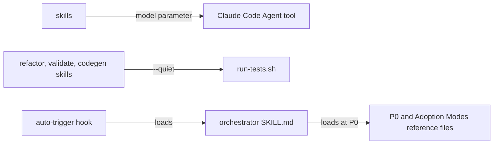

# Execution Plan - token efficiency and Windows shard fix

> Every requirement traces to a user story in `design.md`.

**Skill:** [spec-agent](../skills/planifest-spec-agent/SKILL.md)
**Feature:** 0000038-token-efficiency-windows-shard
**Wave:** 1
**Version:** 0.36.0
**Status:** active

## Active Skills

None.

## Functional Requirements Directory

Functional requirements sit in individual files at `plan/current/requirements/`, one user story per file.

| File | Requirement |
|------|------------|
| [req-001-stable-windows-timing.md](requirements/req-001-stable-windows-timing.md) | One warm-up call and one timed call per timed hook check (US-001) |
| [req-002-model-tiers-take-effect.md](requirements/req-002-model-tiers-take-effect.md) | Dispatch passes only model values the Agent tool accepts (US-002) |
| [req-003-quiet-test-output.md](requirements/req-003-quiet-test-output.md) | `run-tests.sh --quiet` prints failures and totals only (US-003) |
| [req-004-phase-scoped-orchestrator.md](requirements/req-004-phase-scoped-orchestrator.md) | Phase 0 and Adoption Modes move to reference files (US-004) |
| [req-005-context-reset-at-gates.md](requirements/req-005-context-reset-at-gates.md) | Advisory reset prompt after each passed gate (US-005) |
| [req-006-decomposition-size-floor.md](requirements/req-006-decomposition-size-floor.md) | Size floor for subagent dispatch (US-006) |
| [req-007-partial-reads.md](requirements/req-007-partial-reads.md) | Partial-read directive in the boot template (US-007) |

## Cross-cutting deliverables

These have no story of their own. The design scope lists them.

- A re-run-setup migration in `planifest-framework/migrations/`. Skills, the standard, and the boot template change, so installs must re-run `setup.sh` or `setup.ps1`.
- A version bump from 0.35.0 to 0.36.0 in `product.yml`, `docs/about.md`, and `planifest-framework/component.yml`, done at P7.
- Regression copies of the three timed suites stay in step with their originals (req-001).

## Non-Functional Requirements

| ID | Category | Requirement | Target | Measurement |
|----|----------|------------|--------|-------------|
| NFR-001 | Performance | Every timed hook call finishes after one untimed warm-up | under 200 ms, one call, no retry | The three timed suites |
| NFR-002 | Cost | Orchestrator skill size after the Phase 0 and Adoption Modes move | under 41,500 bytes (77,635 today) | `wc -c` on `SKILL.md`, asserted by a test |
| NFR-003 | Cost | Quiet test run output | no `PASS` line and no suite header | Quiet-mode integration test |
| NFR-004 | Quality | No quality gate weakens | zero gate, critic, review, or assertion removed | P4 diff review and the full suite |
| NFR-005 | Compatibility | Default `run-tests.sh` output | byte-identical to today | Integration test and CI |
| NFR-006 | Cost | One-week re-run after release (outside this pipeline) | compare context tokens per request, Opus share, subagent share, Bash bytes per call, cost per request with the 0000230 baseline | Usage profile |

## API Summary

Not applicable. This feature adds no API, so there is no `openapi-spec.yaml`.

## Data Model Summary

Not applicable. This feature changes no schema. `planifest-framework` owns `plan/current/`.

## Component Interactions

## Build order

Requirements are independent except for shared files. Req-002 and req-006 both edit `agent-dispatch-standards.md`. Req-004 and req-005 both edit the orchestrator `SKILL.md`. Run each pair in sequence. The other units can run in parallel.

## Assumptions

| ID | Assumption | Impact if Wrong |
|----|-----------|----------------|
| A-001 | The Claude Code Agent tool honours `model: "sonnet"` and `model: "haiku"` | req-002 saves nothing, and the re-run shows Opus still carrying subagent cost |
| A-002 | The PR #64 failure (203 ms against 200 ms) came from a cold call, 1 usable sample of 1 | If warm calls also pass 200 ms, the check stays red and the hook needs a speed fix under P4 |
| A-003 | The 0000230 profile (6,430 requests, one week) is accurate and this run can't re-read it | The savings estimate moves |
| A-004 | Existing tier mapping holds: primary is `sonnet` and cheaper is `haiku` in the Claude Code column | If the human on the loop wants Opus for a task type, the table needs a design change |

## Verified citations

Checked against the files on 2026-10-24.

| Citation | Design or backlog said | Found |
|----------|------------------------|-------|
| Orchestrator `SKILL.md` size | 77,393 bytes, 823 lines | 77,635 bytes, 823 lines |
| Ship-agent `SKILL.md` size | 42,158 bytes | 42,318 bytes |
| Phase 0 span | lines 239 to 588 | confirmed |
| Adoption Modes span | lines 768 to 818 | confirmed |
| Context Hygiene advisory text | line 235 | confirmed (heading at line 229) |
| Orchestrator lines 675 and 721 | model names | not model names. Line 675 is the cross-model review toggle and line 721 points to the dispatch standard. The dispatch standard and the ship-agent hold the model ids |
| Refactor skill lines 19 and 45 | full-suite runs | confirmed |
| Test files | 116 | 111 top-level `test-*.sh` files plus 33 in `tests/regression/` |
| Timed suites | three with a 200 ms check | `req-003` and `req-007` use `under_200`. `req-009` uses a best-of-three loop at lines 298 to 324 |
| Validate and codegen skills | name the suite runner | neither names `run-tests.sh`. req-003 adds the quiet-mode instruction |

## Open Questions

None blocking.
