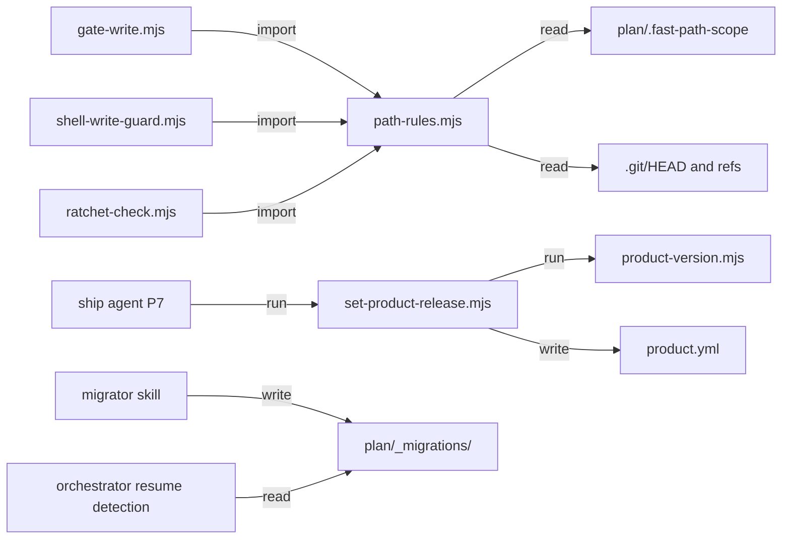

# Execution Plan - write gate scope and path hardening

> Every requirement must be traceable to a user story or acceptance criterion.

**Skill:** [spec-agent](../skills/planifest-spec-agent/SKILL.md)
**Feature:** 0000035-write-gate-scope-and-path-hardening
**Wave:** 1 (single wave)
**Version:** 0.33.0
**Status:** active

## Active Skills

| Skill | Scope | Purpose |
|-------|-------|---------|
| None | n/a | No capability skills apply to this stack. |

## Functional Requirements Directory

Functional requirements are split into individual files, one user story per file, at `plan/current/requirements/`.

| File | Stream | Requirement |
|------|--------|-------------|
| [req-001-fast-path-scope-record.md](requirements/req-001-fast-path-scope-record.md) | `stream-01-gate-rules` | `gate-write` and the shell guard accept `plan/.fast-path-scope` in place of `design.md`, check each write against it, and keep enforcement paths gated. Each admitted write prints a one-line stderr notice (US-001). |
| [req-002-product-yml-in-p7.md](requirements/req-002-product-yml-in-p7.md) | `stream-02-release-manifest` | A new `set-product-release.mjs` step in P7, before the archive, sets `product.yml` `version` and `feature`, and creates `product.yml` from the template when it is missing. It writes through Node, so no write gate judges it (US-002). |
| [req-003-links-judged-by-real-target.md](requirements/req-003-links-judged-by-real-target.md) | `stream-01-gate-rules` | `path-rules.mjs` resolves each segment through links, with a 40-hop limit, before it judges the path (US-003). |
| [req-004-root-when-cwd-deleted.md](requirements/req-004-root-when-cwd-deleted.md) | `stream-01-gate-rules` | `resolveRoot` uses `CLAUDE_PROJECT_DIR`, then the nearest existing parent, when cwd is gone (US-004). |
| [req-005-ratchet-check-shared-root.md](requirements/req-005-ratchet-check-shared-root.md) | `stream-01-gate-rules` | `ratchet-check.mjs` finds `plan/current/` through the shared root and path rules (US-005). |
| [req-006-no-planted-root-marker.md](requirements/req-006-no-planted-root-marker.md) | `stream-01-gate-rules` | `markedRoot` ignores a marker below an always-permitted basename segment (US-006). |
| [req-007-migration-run-state.md](requirements/req-007-migration-run-state.md) | `stream-03-migration-state` | Migration files stay in `planifest-framework/migrations/`, and each project records runs in `plan/_migrations/{stem}.md`. There are eight migrations, plus two helper scripts that belong to `0003-archive-dirname.md` (US-007). |

## Non-Functional Requirements

| ID | Category | Requirement | Target | Measurement |
|----|----------|------------|--------|-------------|
| NFR-001 | Performance | Hook call time with link resolution | Under 500 ms per hook call on a 10-hop link chain | Timed suite case on CI |
| NFR-002 | Security | Path resolution failures inside the root block | Exit 2 with a reason on stderr for a link loop, a chain past 40 hops, or a resolution error inside the root. Enforcement paths match case-insensitively through `norm`. | Suite assertions in req-003 and req-004 |
| NFR-003 | Security | Unexpected errors outside path resolution fail open | Exit 0 (0000003 ADR 005) | Existing suites stay green |
| NFR-004 | Maintainability | Hooks use Node built-ins and spawn no process | No `child_process` import in `path-rules.mjs` or in new code. `ratchet-check.mjs` keeps its existing `git status` spawn, which predates this feature (backlog 0000128). | Suite source check |
| NFR-005 | Reliability | Close-out and migration re-runs are idempotent | A second run leaves every file byte-identical | Suite cases in req-002 and req-007 |

## API Summary

Not applicable. The feature adds no network API. Its contracts are module exports and file formats:

| Contract | Kind | Defined in |
|----------|------|------------|
| `resolveTarget(root, cwd, target)` | ES module export in `path-rules.mjs` | req-003 |
| `FAST_PATH_ENFORCEMENT_PATHS` | ES module export in `path-rules.mjs` | req-001 |
| `plan/.fast-path-scope` | line-based text record | req-001 |
| `set-product-release.mjs --feature-id --version [--root]` | CLI with exit codes 0, 2, 4, 5 | req-002 |
| `plan/_migrations/{stem}.md` | Markdown with YAML frontmatter | req-007 |

## Data Model Summary

| Entity | Owner Component | Key Fields | Relationships |
|--------|----------------|------------|--------------|
| Scope record | `planifest-framework` (Fast Path workflow) | `branch`, `head`, `paths` | Read by `gate-write` and the shell guard |
| Migration record | `planifest-framework` (migrator skill) | `migration`, `outcome`, `date`, `framework-version`, `corrections-applied`, `corrections-skipped` | One per top-level `*.md` file in `planifest-framework/migrations/` (eight) |
| `product.yml` release fields | `planifest-framework` (ship agent) | `version`, `feature` | Checked against `product-version.mjs` |

## Component Interactions

## Build order (P3)

- `stream-01-gate-rules`: one agent builds all five requirements in sequence, because each changes `path-rules.mjs`. The order is req-006, req-004, req-003, req-005, then req-001.
- `stream-02-release-manifest` and `stream-03-migration-state` run in parallel with stream 01.
- Shared files: stream 01 and stream 03 may both edit `planifest-framework/skills/planifest-orchestrator/SKILL.md` and `planifest-framework/pipeline-reference.md`. The orchestrator orders those edits at P3. Stream 03 edits only its named sections.
- `planifest-framework/component.yml` moves to `0.33.0` before P7. The orchestrator makes that edit, not a stream.

## Decisions recorded at P1

- Migration findings in `autonomous`: if a scan in this repo finds content to correct, P3 writes no record for that migration. The migration stays pending, and an `Exception waiting (P3, human review)` line lists the findings for the final report. This follows the confirmed rule that a scan with findings records nothing until the human on the loop confirms the fix. AC-007.3 then stays open for the human on the loop, and P4 reports it as blocked on that review.
- The scope record never enters a commit. Fast Path step 6 removes it before `git commit`. This sharpens the brief's "deletes it in the Fast Path commit" criterion.
- The scope record is self-authorisation. The human on the loop accepted this at P0 over a wider allowlist. Each write admitted through the record prints a one-line stderr notice. The branch and `HEAD` binding bounds staleness only and is not a security control (R-005).
- `FAST_PATH_ENFORCEMENT_PATHS` makes the `fast-path.md` list concrete and adds the hook wiring files that setup writes, such as `.claude/settings.json`, and `.git/`. The same change updates `fast-path.md`. No path leaves the list.
- Hop limit is 40. A link loop, a chain past 40 hops, or a resolution error inside the root blocks with exit 2. The scope record is removed before the Fast Path commit and never enters a commit.
- `set-product-release.mjs` writes `product.yml` through Node and creates it from the template when needed. P2 records the script as an ADR, as 0000033 ADR 010 did for `archive-current.mjs`.
- A missing cwd now blocks a write into `src/`. This supersedes the 0000032 suite assertion at `test-0000032-req-006-outside-repository-pass.sh` lines 364 to 366.

## Assumptions

| ID | Assumption | Impact if Wrong |
|----|-----------|----------------|
| A-001 | Claude Code passes `CLAUDE_PROJECT_DIR` to hooks. | The deleted-cwd fix falls back to the nearest existing parent only. |
| A-002 | Git state for the scope record can be read from `.git/HEAD`, loose refs, `commondir`, and `packed-refs` without a spawn. | A reftable repository can't use Fast Path writes, because the gate ignores the record and fails closed. |
| A-003 | The six older migrations' scans still run against today's layout. | A scan reports false findings, and the run lists them for the human on the loop. |

## Open Questions

None. Every open choice became a recorded decision under the `autonomous` decision rule.
