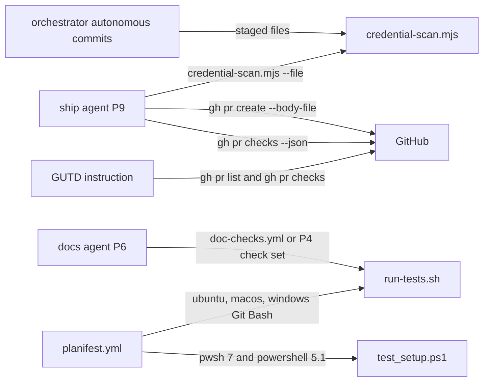
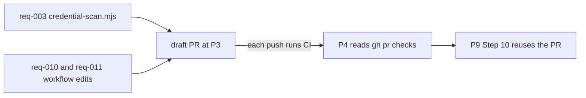

# Execution Plan - green CI before ship

> Every requirement must be traceable to a user story or acceptance criterion.

**Skill:** [spec-agent](../../planifest-framework/skills/planifest-spec-agent/SKILL.md)
**Feature:** 0000037-green-ci-before-ship
**Wave:** 1
**Version:** 0.35.0
**Status:** active

## Active Skills

| Skill | Scope | Purpose |
|-------|-------|---------|
| none | n/a | No capability skill applies to this stack |

## Functional Requirements Directory

Functional requirements are split into individual files, one user story per file, at `plan/current/requirements/`.

| File | Requirement | Stream |
|------|------------|--------|
| [req-001-p9-ci-check.md](requirements/req-001-p9-ci-check.md) | P9 waits for the PR's checks, fixes red checks, and reports the result | 01 |
| [req-002-gutd-ci-check.md](requirements/req-002-gutd-ci-check.md) | GUTD reports the last merged PR's checks | 01 |
| [req-003-pre-commit-credential-scan.md](requirements/req-003-pre-commit-credential-scan.md) | `credential-scan.mjs` scans staged files before each `autonomous` commit and holds back the push on a match | 01 |
| [req-004-pr-body-scan.md](requirements/req-004-pr-body-scan.md) | The PR title and body pass the scan before `gh pr create`, and PR text cites paths only | 01 |
| [req-005-post-p6-revalidation.md](requirements/req-005-post-p6-revalidation.md) | Post-P6 revalidation runs after the P6 commit, logs one line, and loops under the approach rules | 02 |
| [req-006-verified-by-and-p3-scan.md](requirements/req-006-verified-by-and-p3-scan.md) | A "Verified by" field on criteria, and a requirement-ID scan before P3 closes | 02 |
| [req-007-wired-command-test.md](requirements/req-007-wired-command-test.md) | A suite runs the hook command strings that `setup.sh` writes | 03 |
| [req-008-migration-branch-diff-test.md](requirements/req-008-migration-branch-diff-test.md) | A suite compares the newest re-run-setup migration's file list with the release diff | 03 |
| [req-009-portable-suites-and-lint.md](requirements/req-009-portable-suites-and-lint.md) | Every suite passes from any working directory, and a portability lint runs in the suite | 03 |
| [req-010-windows-git-bash-leg.md](requirements/req-010-windows-git-bash-leg.md) | The suite runs on `windows-latest` under Git Bash, with recorded skips | 04 |
| [req-011-windows-powershell-coverage.md](requirements/req-011-windows-powershell-coverage.md) | `setup.ps1` runs under Windows PowerShell 5.1, and `test_setup.ps1` runs the stale clean-up live | 04 |

## Non-Functional Requirements

| ID | Category | Requirement | Target | Measurement |
|----|----------|------------|--------|-------------|
| NFR-001 | Performance | P9 waits for the PR's checks for a bounded time | At most 20 minutes, polling every 30 seconds | Step 10c text and the req-001 suite |
| NFR-002 | Performance | Each new CI job finishes within its cap | `timeout-minutes: 10` on every new job | Workflow file and the req-010 and req-011 suites |
| NFR-003 | Security | New CI jobs hold no secrets and read only | `permissions: contents: read`, no `secrets.` reference, `pull_request` trigger only (0000031 ADR 003) | Workflow file and the req-010 and req-011 suites |
| NFR-004 | Security | The credential scan never prints a matched value | 0 matched values in script output, build-log lines, or PR text | req-003 and req-004 suites with a planted test credential |
| NFR-005 | Reliability | Every suite passes from any starting directory | 0 suites fail from the repository root, `planifest-framework/tests/`, or a temporary directory. Baseline: 130 suites before this feature. | req-009 suite |

## API Summary

Not applicable. The feature adds no API.

## Data Model Summary

Not applicable. The feature adds no data store. The build log stays owned by the orchestrator, and GitHub check state stays read only.

## Component Interactions

## Build Order for CI

CI runs only on `pull_request`, so the orchestrator raises a draft PR during P3 ("CI before P4" in `design.md`). P3 builds req-003 first, so `credential-scan.mjs` can scan the draft PR text. The req-010 and req-011 workflow edits land before the draft PR opens, so its first run holds both Windows legs.

## Release Delivery

The feature changes skills, standards, a template, and a new script that setup delivers. The orchestrator therefore writes `planifest-framework/migrations/migrate-0.35.0-rerun-setup.md` at the end of P6. The req-008 suite checks its file list against the diff from `v0.34.0`.

## Assumptions

Each is a risk item with likelihood: medium. The risk register holds the full list (A-001 to A-006).

| ID | Assumption | Impact if Wrong |
|----|-----------|----------------|
| A-001 | `gh` is signed in where P9 and GUTD run | The check reports "CI status could not be read", and the run doesn't read as done |
| A-002 | Windows runners ship Git Bash and Windows PowerShell 5.1 | The new legs need an install step |

## Open Questions

None. Every question raised at P1 became a recorded decision in `build-log.md`.
