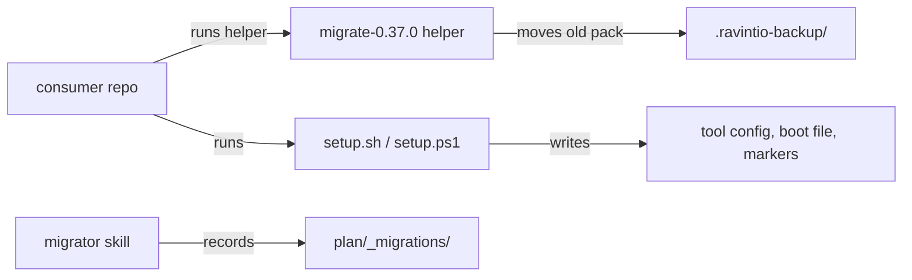

# Execution Plan - ravintio-rebrand

> Every requirement must be traceable to a user story or acceptance criterion.

**Skill:** [spec-agent](../skills/planifest-spec-agent/SKILL.md)
**Feature:** 0000039-ravintio-rebrand
**Wave:** 1 (single wave)
**Version:** 0.37.0
**Status:** active

## Active Skills

| Skill | Scope | Purpose |
|-------|-------|---------|
| None | plan | No capability skills apply. The stack is unchanged shell, PowerShell, and Node. |

## Functional Requirements Directory

Functional requirements are split into individual files, one concern per file, at `plan/current/requirements/`.

Each file follows the naming convention `req-{NNN}-{kebab-slug}.md` and the [Requirement Template](../templates/requirement.template.md).

| File | Requirement | Story |
|------|------------|-------|
| [req-001-pack-paths-and-identifiers.md](requirements/req-001-pack-paths-and-identifiers.md) | The scripted pass renames every pack path and identifier, and git records the moves as renames | US-001 |
| [req-002-runtime-names.md](requirements/req-002-runtime-names.md) | Setup moves marker files, boot-file blocks, and installed skills to the new names, and stops while the old pack exists | US-001 |
| [req-003-environment-variables.md](requirements/req-003-environment-variables.md) | `PLANIFEST_*` becomes `RAVINTIO_*`, with one fallback for `PLANIFEST_SESSION_ID` | US-001 |
| [req-004-brand-prose.md](requirements/req-004-brand-prose.md) | Prose and repo links say RAVINTIO, and the `setup.sh` mojibake bytes stay as they are | US-001 |
| [req-005-history-and-split-name-protection.md](requirements/req-005-history-and-split-name-protection.md) | The protected list and the split-name rules for the scripted pass, with every history reader still green | US-001 |
| [req-006-consumer-migration.md](requirements/req-006-consumer-migration.md) | The `.sh` and `.ps1` helpers move a consumer to the new names and back up the old pack | US-002 |
| [req-007-brand-guard.md](requirements/req-007-brand-guard.md) | A Bash 3.2-safe suite fails on any old name outside a path and line allowlist | US-003 |
| [req-008-emitted-names.md](requirements/req-008-emitted-names.md) | Hooks and setup emit the new root marker, hook path, log prefix, npm scope, workflow name, and boot-file paths | US-001 |
| [req-009-migration-ordering-and-old-paths.md](requirements/req-009-migration-ordering-and-old-paths.md) | The migrator runs older migrations against the new paths and honours `Applies when:` | US-002 |
| [req-010-version-bump.md](requirements/req-010-version-bump.md) | P6 writes 0.37.0 to the product manifest, the pack manifest, and the about page | US-004 |

## Build order

The scripted pass is the step every other requirement waits on, so P3 runs in three stages:

1. **Before the pass:** req-005 lists the protected inventory. Its tests and the brand guard suite (req-007) are written first and fail as expected.
2. **The pass:** req-001 runs the script once, re-runs `setup.sh claude-code`, and commits. The build log names the new orchestrator skill in the same commit.
3. **After the pass:** req-002, req-003, req-004, req-006, req-008, and req-009 run as TDD tracks. Each track touches its own files. req-007 goes green last, once the allowlist is final.

## Non-Functional Requirements

| ID | Category | Requirement | Target | Measurement |
|----|----------|------------|--------|-------------|
| NFR-001 | Completeness | No live file or path holds the old name outside the allowlist | 0 unallowlisted hits | brand guard suite (req-007) |
| NFR-002 | Regression | The full suite passes on every CI leg | 0 failing suites on ubuntu, macOS, the Windows shards, and both PowerShell legs | CI on the PR |
| NFR-003 | History | Existing history files stay byte-identical | 0 modified, deleted, or renamed files under `plan/_archive/`, `plan/changelog/`, and `plan/_migrations/`. Added files, such as this feature's archive folder, changelog entry, and migration record, don't count. | `git diff --name-status --diff-filter=MDR main...HEAD -- plan/_archive plan/changelog plan/_migrations ':(glob)plan/backlog/*/_reference/**'` prints nothing. Shipped migration bodies move with the pack folder, so req-005's first criterion checks them by content against the pre-pass commit. |
| NFR-004 | Security | The migration helpers never delete pack files or follow a link | 0 delete calls on the old pack, and every link case refused | req-006 suites and the P5 review |

## API Summary

Not applicable. The feature builds no API, so no `openapi-spec.yaml` exists.

## Data Model Summary

No database. The data the feature changes are files.

| Entity | Owner Component | Key Fields | Relationships |
|--------|----------------|------------|--------------|
| Pack tree | `ravintio-framework` | folder and file names | consumers copy it in |
| Consumer marker files | `ravintio-framework` | `.ravintio-session`, `.ravintio-manifest`, `.ravintio-setup-flags` | setup writes them, and refresh-setup reads the flags file |
| Migration records | `ravintio-framework` (the migrator) | `migration`, `outcome`, `date` | one per shipped migration |

## Component Interactions

## Assumptions

Each is a risk item with likelihood: medium.

| ID | Assumption | Impact if Wrong |
|----|-----------|----------------|
| A-001 | Consumers set no `PLANIFEST_*` variable except `PLANIFEST_SESSION_ID` | A consumer setting loses effect after the upgrade |
| A-002 | A consumer on 0.36.0 runs the helper by hand, because its installed orchestrator scans only `planifest-framework/migrations/` | The consumer never learns of the migration unless the release notes and the setup stop message name it |
| A-003 | GitHub keeps redirecting the old repo URL after the rename | Old clones and links break until their remotes change |

## Open Questions

None. Every gap the drafters found has a decision in the build log.
