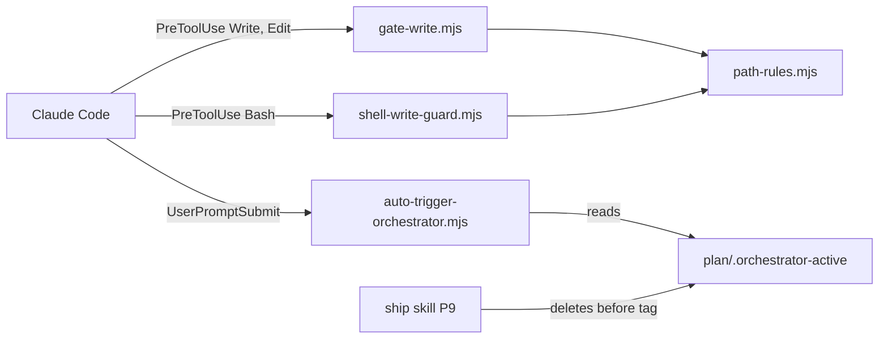

# Execution Plan - Governance continuity and write-gate scope

> Every requirement must be traceable to a user story or acceptance criterion.

**Skill:** [spec-agent](../../planifest-framework/skills/planifest-spec-agent/SKILL.md)
**Feature:** 0000032-governance-continuity-and-write-gate-scope
**Version:** 0.31.0
**Status:** active

## Active Skills

| Skill | Scope | Purpose |
|-------|-------|---------|
| None | | No capability skills apply to this run |

## Functional Requirements Directory

Each file covers one user story and follows the [Requirement Template](../../planifest-framework/templates/requirement.template.md).

| File | Requirement | Brief criteria |
|------|------------|----------------|
| [req-001-run-lifecycle.md](requirements/req-001-run-lifecycle.md) | Markers stay until P8 ends and leave in a P9 commit before the tag. Step 2a resumes P8 or P9 from archive evidence. | AC-1, AC-2 |
| [req-002-post-run-triage.md](requirements/req-002-post-run-triage.md) | The auto-trigger hook asks for triage, handover notes route through a track, and Step 12 blocks new work until context is cleared. | AC-3, AC-4, AC-5 |
| [req-003-write-gate-scope.md](requirements/req-003-write-gate-scope.md) | A shared path-rules module passes paths outside the git top-level. Every hook that exits 2 writes its reason to stderr. | AC-6, AC-7 |
| [req-004-shell-write-guard.md](requirements/req-004-shell-write-guard.md) | A Bash PreToolUse hook applies the same path rules to shell writes, with idempotent setup registration, a boot-file rule, and a 0.31.0 migration. | AC-8 to AC-11 |

Build order: req-001, then req-002, because both edit the ship skill. req-003, then req-004, because req-004 imports the shared module. The two pairs touch different files and can run in parallel.

## Non-Functional Requirements

| ID | Category | Requirement | Target | Measurement |
|----|----------|------------|--------|-------------|
| NFR-001 | Performance | Changed and new hooks stay fast | Under 200 ms per call on the CI runners | Timed in the req-003 and req-004 suites |
| NFR-002 | Reliability | Hooks fail open on unexpected input | Exit 0 for malformed stdin, JSON with no `command`, and a non-string `command` | Fail-open cases in each changed or new hook's suite |
| NFR-003 | Accuracy | The shell guard doesn't block read-only commands | Zero blocks on the false-positive corpus | Corpus test in the req-004 suite |
| NFR-004 | Accuracy | The shell guard catches the AC-8 writer forms | Blocks every command in the detection corpus | Corpus test in the req-004 suite |

## API Summary

Not applicable. This feature changes skills, hooks, and setup scripts, and exposes no API.

## Data Model Summary

| Entity | Owner Component | Key Fields | Relationships |
|--------|----------------|------------|--------------|
| `plan/.orchestrator-active` | planifest-framework | feature ID | Read by hooks and Resume Detection. Locates the archive at step 2a. |
| `plan/.orchestrator-ack` | planifest-framework | session ID or timestamp | Read by `check-orchestrator-presence.mjs` |
| `plan/.run-mode` | planifest-framework | `continuous` or `interactive` | Read at resume |

## Component Interactions

## Assumptions

Each is a risk item with likelihood: medium.

| ID | Assumption | Impact if Wrong |
|----|-----------|----------------|
| A-001 | Claude Code shows a PreToolUse block reason from stderr when a hook exits 2 | AC-7 fixes nothing for Claude Code |
| A-002 | Claude Code passes the Bash command as `tool_input.command` | The shell guard never sees a command and always passes |
| A-003 | Hooks look up `plan/` and `design.md` from the repository root, found by walking up from `cwd` to the first folder holding `planifest-framework/` or `.git`, with no `git` spawn | A session started in a subfolder would see no design and block every gated write |
| A-004 | Both sides of the root comparison use real paths. A missing target resolves through its nearest existing parent. | An in-repository write could look outside and bypass the gate |
| A-005 | The `plan/current/` sentinel check applies to shell writes too, because the guard matches `gate-write` exactly | Shell writes to plan artifacts before P0 would be blocked. That is the intended parity. |
| A-006 | A write target with a glob or variable is judged by its literal prefix. A target with no literal prefix gets a warning and passes. A `cd` with one literal argument is tracked. | `cp a "$DIR/x"` passes the guard. The boot-file rule covers it. |
| A-007 | Tools that relay both stdout and stderr show a block reason twice | The reason appears twice in Cursor, Cline, and OpenCode, and nothing breaks |
| A-008 | Both `standard-boot.md` and `cursor-boot.md` gain the Write-or-Edit rule. Tools without the shell guard need the rule most. | None. The rule is text only. |

## Open Questions

None. The human on the loop reviewed A-003 to A-008 after P1. A-003 to A-005 were confirmed one at a time. A-006 to A-008 took the orchestrator's recommendation when the human returned to continuous mode.
