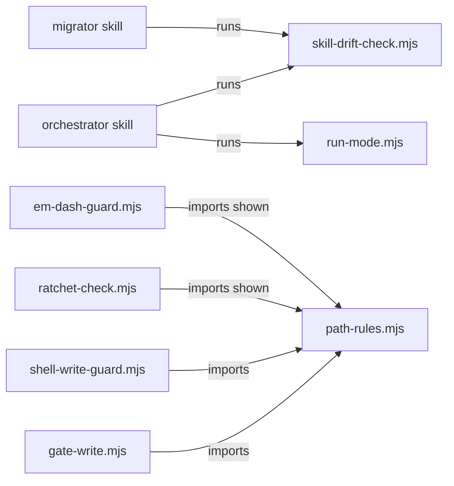

# Execution Plan - pipeline friction and gate fixes

> Every requirement must be traceable to a user story or acceptance criterion.

**Skill:** [spec-agent](../../planifest-framework/skills/planifest-spec-agent/SKILL.md)
**Feature:** 0000036-pipeline-friction-and-gate-fixes
**Wave:** 1 (single wave)
**Version:** 0.34.0
**Status:** active

## Active Skills

| Skill | Scope | Purpose |
|-------|-------|---------|
| None | n/a | No capability skills apply to this stack. |

## Functional Requirements Directory

Functional requirements are split into individual files, one user story per file, at `plan/current/requirements/`.

| File | Stream | Requirement |
|------|--------|-------------|
| [req-001-rerun-setup-migration.md](requirements/req-001-rerun-setup-migration.md) | `stream-02-setup-and-drift` | One 0.34.0 migration re-runs setup for the setup-delivered changes in 0.33.0 and 0.34.0. The update policy requires such a migration (US-001). |
| [req-002-skill-drift-check.md](requirements/req-002-skill-drift-check.md) | `stream-02-setup-and-drift` | `skill-drift-check.mjs` compares each source `SKILL.md` with the active tool's installed copy, after setup's path rewrites. The orchestrator runs it at session start (US-002). |
| [req-003-ship-commit-subjects.md](requirements/req-003-ship-commit-subjects.md) | `stream-03-skill-text` | Commit subject templates drop their placeholders, and the feature ID moves to the body (US-003). |
| [req-004-run-mode-anchor-format.md](requirements/req-004-run-mode-anchor-format.md) | `stream-03-skill-text` | `run-mode.mjs` accepts a bare anchor line or one `- ` list item. The skill and template show the exact line (US-004). |
| [req-005-hard-limits-cited-by-name.md](requirements/req-005-hard-limits-cited-by-name.md) | `stream-03-skill-text` | Every hard-limit citation names its rule and source. The dispatch template states the Write-or-Edit rule (US-005). |
| [req-006-design-critic-default.md](requirements/req-006-design-critic-default.md) | `stream-03-skill-text` | An absent `design_critic` key or file reads as `report-only` outside `autonomous` (US-006). |
| [req-007-story-split-step.md](requirements/req-007-story-split-step.md) | `stream-03-skill-text` | Three skills carry a split step before a requirement reaches a fourth criterion (US-007). |
| [req-008-non-regular-design-md.md](requirements/req-008-non-regular-design-md.md) | `stream-01-gate-and-tests` | The write gate checks the file type of `design.md` before it opens it. A non-regular file or a throwing `lstat` reads as no design (US-008). |
| [req-009-permitted-names-in-enforcement-paths.md](requirements/req-009-permitted-names-in-enforcement-paths.md) | `stream-01-gate-and-tests` | The always-permitted file-name shortcut skips enforcement paths (US-009). |
| [req-010-run-tests-clears-project-dir.md](requirements/req-010-run-tests-clears-project-dir.md) | `stream-01-gate-and-tests` | `run-tests.sh` clears `CLAUDE_PROJECT_DIR`, and every suite that names an enforcement hook clears it too (US-010). |
| [req-011-escaped-hook-output.md](requirements/req-011-escaped-hook-output.md) | `stream-01-gate-and-tests` | Two hooks print quoted text through `shown()`, and `shown()` cuts only between whole units (US-011). |

## Non-Functional Requirements

| ID | Category | Requirement | Target | Measurement |
|----|----------|------------|--------|-------------|
| NFR-001 | Performance | Hook call time with the added `lstat` and `fstat` | Under 500 ms per hook call | A timed case in the req-008 suite runs `gate-write.mjs` with a regular `design.md` |
| NFR-002 | Performance | Drift check run time | Under 1 s on this repo | A timed case in the req-002 suite runs the script against this repo |
| NFR-003 | Security | Hooks stay on Node built-ins | No `child_process` import and no import outside `node:` in any enforcement hook | Suite source check |
| NFR-004 | Security | A FIFO never holds a hook | Each hook exits inside the suite's 5-second limit with a FIFO at `design.md` | req-008 suite case |
| NFR-005 | Reliability | Commit subjects from skill templates | Every template subject is 72 characters or fewer and holds no placeholder | req-003 suite, which runs `hooks/commit-msg` |

## API Summary

Not applicable. The feature builds no API.

## Data Model Summary

Not applicable. The feature owns no data store. It reads repository files only. `scope.md` lists the files each component owns.

## Component Interactions

## Assumptions

Each is a risk item with likelihood: medium.

| ID | Assumption | Impact if Wrong |
|----|-----------|----------------|
| A-001 | Setup's four path rewrites and the PowerShell byte order mark are the only changes setup makes to a `SKILL.md` copy | The drift check reports false drift |
| A-002 | Each tool's `.planifest-setup-flags` marker names the tool that setup installed | The drift check checks the wrong folders, then falls back to every folder it finds |
| A-003 | `fs.constants` defines `O_NONBLOCK` and `O_NOFOLLOW` on Linux and macOS | The read loses its guard against a swap between `lstat` and open, and `lstat` alone still guards it |

## Open Questions

None. Each P1 decision sits in the build log.
